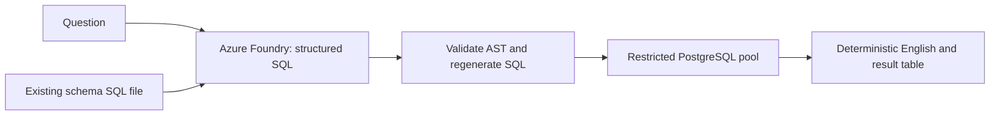

# AI assistant (M4, reviewed in M5)

## Current verification status

The feature is implemented, but **no real Azure model call has been made**.
Azure configuration is blank locally. Tests use deterministic model responses
and an intercepted OpenAI SDK transport; database integration tests use the real
local PostgreSQL server and the real restricted login. Passing these tests does
not establish compatibility with a particular Azure deployment or its SQL quality.
There is no production mock mode, provider fallback, or fabricated answer when
Azure is unavailable. The endpoint returns HTTP 503 when configuration is absent.

## Question to answer



1. The browser sends only `{ "message": "..." }`. Previous messages stay in the
   browser and are never included in a model request. There is no conversation memory.
2. `model.js` sends the current question, system instructions, business rules,
   and the actual `db/init/01-schema.sql` contents to the configured Azure model.
   It requests strict JSON containing only `sql`, a string or null. Null means
   the question cannot be answered from the schema. Refusals, truncated output,
   malformed JSON, and extra properties are rejected safely.
3. `sql.js` parses the SQL with `pgsql-ast-parser`. An explicit allowlist checks
   every supported AST node and field. It regenerates accepted syntax, qualifies
   tables with `public`, binds string literals as `$1`, `$2`, etc., and applies a
   limit of 51 rows (50 displayed plus one to detect truncation). Original model
   SQL is never passed directly to PostgreSQL.
4. `database.js` checks the login's actual permissions, opens a read-only
   transaction, applies limits, and executes through PostgreSQL's extended
   protocol. That protocol independently rejects a second statement. Transactions
   are rolled back and connections released, including after errors.
5. `assistant.js` constructs an English response directly from the returned data.
   Single values appear in the answer; multi-column results appear in a table.
   There is **no second model call**, so returned customer records are not sent
   back to Azure and a summarizing model cannot invent numbers. The existing pure
   string money formatter is reused in Node without browser dependencies.
6. The frontend renders all content using `textContent` and DOM methods. A
   collapsible section shows the normalized executed SQL, with placeholders;
   bound string values are deliberately omitted from the response's SQL field.

The model receives schema and the current question, which may itself mention a
customer. It receives no database password, Azure key, seed script, or query results.

## Business rules

All money is SEK excluding VAT. Sales and customer spending use only completed
orders. Values use historical `order_items.unit_price`; round each line to two
decimal places before summing. Quantities retain decimals. Calculations remain
in PostgreSQL `NUMERIC`, and numeric results remain exact JSON strings.

"Best-selling" defaults to completed revenue in SEK. The prompt asks for SKU and
article name. Quantities of different units must not be added into one total.
More specific questions can ask about a particular article and unit.

The model chooses the query's meaning. Structural validation establishes its
permitted access and syntax, **not that it correctly interprets the question or
uses the right sales filter**. A permitted but incorrect query can still produce
a wrong business conclusion. Inspect the SQL and evaluate the real deployment
before relying on its answers. Prompt injection is treated as untrusted input;
the security boundary remains validation plus database permissions and limits.

## Local read-only login setup

Use the existing local Docker database. Do not run this setup against a shared
or production database without reviewing its permission changes.
For Azure Flexible Server, follow the [managed-provider plan](DEPLOYMENT.md#managed-postgresql-bootstrap-required-m6b-work);
the local superuser setup is not assumed to work unchanged on a managed service.

1. In the ignored `.env`, set `AI_PGUSER=floorflow_ai` and a new
   `AI_PGPASSWORD` different from `PGPASSWORD`. Never commit real credentials.
2. Start PostgreSQL, install locked dependencies, and run the setup with the
   existing application's local database-owner/superuser connection:

```powershell
docker compose up -d --wait
npm ci
npm run db:assistant:setup
```

The script creates or reconfigures the dedicated login, grants schema usage and
SELECT on exactly the four application tables, removes direct table/sequence
privileges, and configures conservative defaults. It refuses an existing role
with administrative flags, memberships, or object ownership. It does not modify
schema definitions or seed rows. Re-running it applies the current local password.

PostgreSQL grants temporary-table privileges to `PUBLIC` by default. A per-role
REVOKE cannot override a grant inherited from `PUBLIC`, so the setup revokes
database CREATE/TEMPORARY and public-schema CREATE from `PUBLIC` in **FloorFlow's
database**. The existing database owner retains its privileges. This affects
other non-owner logins in that database, which is why the procedure is intended
for the dedicated local development database.

The application uses a separate two-connection pool with this login. It refuses
the normal application account and also refuses equal normal/AI passwords.
Each execution checks for administrative rights, memberships, write permissions,
and missing SELECT grants. Future schema/permission changes need review: the
role is not automatically granted access to new tables. PostgreSQL exposes some
catalog metadata and built-in functions to ordinary users; database grants alone
are not a complete SQL sandbox. The AST policy blocks those accesses through
the assistant. The database administrator remains trusted.

The role's default read-only mode is a precaution; PostgreSQL permits an ordinary
user to request a read-write transaction. Actual ACLs independently deny writes.
Tests explicitly verify this distinction, including denial of temporary tables.

## Supported SQL and execution limits

| Boundary | Policy |
| --- | --- |
| Question | 1–1000 characters; JSON body at most 4 KiB |
| Model | One request, 20-second timeout, no retries, at most 1200 completion tokens |
| Model response / SQL text | At most 8000 / 6000 characters |
| Tables | Only the four `public` tables, at most once each |
| Joins | INNER/LEFT joins with a declared foreign-key equality |
| Expressions | Approved columns, comparisons, boolean/arithmetic operators, small integer literals, string literals, NULL, casts to NUMERIC |
| Functions | SUM, COUNT, MIN, MAX, AVG, ROUND, COALESCE, LOWER, UPPER |
| Output shape | At most 8 columns, unique simple aliases; selected expressions must depend on application data; scalar values and ISO timestamps only |
| Complexity | At most 200 expression nodes, depth 16, and 40 opening parentheses |
| Database | READ ONLY; trusted search path `pg_catalog`; extended protocol |
| Time | Statement timeout 2 seconds; lock timeout 500 ms; driver read timeout 4 seconds; role transaction/idle-in-transaction timeout 5 seconds |
| Resources | Work memory 4 MiB; temporary-file limit 8 MiB; pool size 2 |
| Results | At most 50 displayed rows and 32000 UTF-8 bytes of result data |
| Abuse/cost | One active request; 5 accepted requests/IP/minute; 30 accepted requests/process/hour |

Unknown node types or properties fail closed. CTEs, subqueries, UNION, windows,
SELECT INTO, locks, SELECT *, table functions, cross/self joins, custom schemas,
custom functions/operators/collations, offsets, and administrative commands are
unsupported. This intentionally excludes some safe PostgreSQL syntax too.
Use simple SQL rather than expanding the validator to accommodate every model response.

The parser represents numeric literals as JavaScript numbers. To avoid literal
precision loss, the policy accepts only bounded integer literals (absolute value
at most 1000000) and numeric zero. M5 uses parser source locations to ensure a
nonzero decimal cannot underflow to zero and change meaning during regeneration.
Other decimal constants are rejected. Actual
stored monetary values and calculations are always PostgreSQL NUMERIC.

The row cap bounds output, while database timeouts and resource settings also
limit work needed to produce it. These are conservative limits, not an operating
system resource sandbox. The response byte cap is checked after bounded rows
are read; exceptionally large future TEXT fields can still consume memory.

Rate limits are held in process memory and reset on restart. They are suitable
for this local MVP, not durable spending limits across several cloud instances.
M5 adds a server-side preview gate covering the assistant and all other routes.
See [READINESS.md](READINESS.md) for production HTTPS, proxy trust, shared-password
limitations and provider budgets. No public service is deployed here.

## Azure Foundry configuration (later, with approval)

No resources are provisioned by this code. Eventually an existing Azure Foundry
resource, deployed model supporting Chat Completions and strict JSON-schema
outputs, resource API key, and network access will be needed. Configure:

```dotenv
AZURE_FOUNDRY_ENDPOINT=https://YOUR-RESOURCE.services.ai.azure.com/openai/v1/
AZURE_FOUNDRY_MODEL=YOUR-ACTUAL-DEPLOYMENT-NAME
AZURE_FOUNDRY_API_KEY=YOUR-RESOURCE-API-KEY
```

The `https://YOUR-RESOURCE.openai.azure.com/openai/v1/` hostname format is also
accepted. Supply the complete resource v1 endpoint including the trailing slash;
project endpoints, arbitrary provider hosts, credentials in URLs, and query strings
are rejected. There is no date-based `api-version`, Azure AI Inference SDK,
agent framework, or fallback provider. The official `openai` package receives
the deployment name as `model`. A real deployment must support the requested
structured-output and `max_completion_tokens` parameters; mocks do not prove this.

**Only after explicit approval for a paid test**, restart the app with configured
credentials and submit one question through the UI or:

```powershell
Invoke-RestMethod -Method Post -Uri http://127.0.0.1:3000/api/assistant/chat -ContentType application/json -Body '{"message":"How much have we sold in total?"}'
```

For a correct query against the unchanged seed, expect `285415.00` as completed
sales. Inspect the SQL and returned rows. Unsupported SQL should be rejected;
do not remove safeguards or automatically retry to make a model response pass.
Actual prices, deployment capabilities, permissions, latency, and output quality
still require verification with the chosen Azure deployment.
Use the [real Azure acceptance checklist](AZURE_ACCEPTANCE.md): completed-only
filters, historical pricing, line-level rounding, article selection and rankings
must be checked against actual model output, not replaced with a SQL mock.

## Testing without Azure

Leave all Azure values blank. Set up the separate local database login, then:

```powershell
npm test
```

The original 99 tests remain unchanged. New tests exercise the official SDK with
an intercepted transport, deterministic model mocks, API validation, response
grounding, malformed/refused/truncated output, provider errors/timeouts, cost
limits, dangerous SQL and parser-bypass cases. Real PostgreSQL tests verify seed
sales/spending/quantities/rankings, large NUMERIC results, ACL restrictions even
in READ WRITE mode, READ ONLY transactions, statement/lock timeouts, and extended
protocol single-statement enforcement. Row-count and byte-cap edge cases use
simulated result rows after real role/transaction checks; they are not load tests.

No test calls a paid model or provisions a cloud resource. No test permanently
changes seed rows. SQL failures intentionally exercised by tests can appear in
local PostgreSQL logs; the application itself does not log prompts, results,
generated SQL, keys, passwords, or provider error bodies.

## Sources

- [Microsoft: Azure Foundry v1 API](https://learn.microsoft.com/en-us/azure/foundry/openai/api-version-lifecycle)
- [Microsoft: structured outputs](https://learn.microsoft.com/en-us/azure/foundry/openai/how-to/structured-outputs)
- [Official OpenAI SDK](https://github.com/openai/openai-node)
- [SQL parser and AST regeneration](https://github.com/oguimbal/pgsql-ast-parser)
- [PostgreSQL privileges](https://www.postgresql.org/docs/18/ddl-priv.html)
- [PostgreSQL read-only transactions and timeouts](https://www.postgresql.org/docs/18/runtime-config-client.html)
